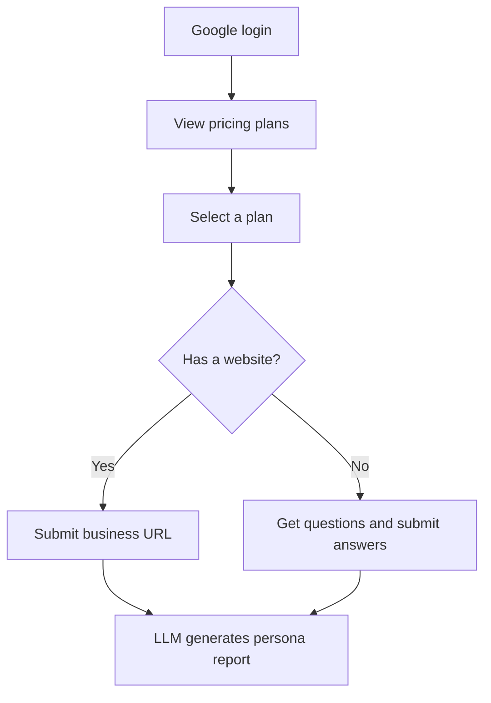

# Jubala Onboarding & Pricing API

**Backend for a pricing and onboarding journey.** A new user signs in with Google, picks a pricing plan, tells the system about their business (by website URL or by answering questions), and receives an AI-generated persona report.


[**Why**](#why) · [**User journey**](#user-journey) · [**API**](#api) · [**Project structure**](#project-structure) · [**Getting started**](#getting-started) · [**Limits**](#limits)

---

## Why

New users drop off when signing up is slow or unclear. This API gives the front end one clear path: sign in, see plans, choose one, describe the business, and get a personalised persona report at the end. Users who have a website can skip the questionnaire by sharing the URL.

> **Why I built it.** *(Write 2-3 lines in your own words: what your part of the project was and what you learned.)*

---

## User journey



1. **Sign in** with Google (OAuth).
2. **Browse plans** returned by the pricing endpoint.
3. **Select a plan** for the signed-in user.
4. **Describe the business**: send a website URL, or receive questions and submit answers.
5. **Generate the persona report** with an LLM.

---

## API

| Step | Method | Endpoint | Purpose |
|------|--------|----------|---------|
| 1 | `GET` | `/api/v1/auth/google/login` | Start Google login |
| 2 | `GET` | `/api/v1/plans` | List pricing plans |
| 3 | `POST` | `/api/v1/users/select-plan` | User selects a plan |
| 4 | `POST` | `/api/v1/onboarding/business-info` | Submit a URL, or get questions if there is no URL |
| 5 | `POST` | `/api/v1/onboarding/submit-answers` | Submit answers (when no URL was given) |
| 6 | `POST` | `/api/v1/persona/generate` | Generate the persona report with the LLM |
| - | `GET` | `/health` | Service health check |

Interactive docs are available at `/docs` (Swagger UI) once the server is running.

---

## Project structure

```
.
├── main.py                  # App setup, middleware, router registration
├── config.py                # Settings loaded through get_settings()
└── routers/
    ├── auth_router.py       # Google OAuth login
    ├── plans_router.py      # Pricing plans
    ├── onboarding_router.py # Business info and answers
    └── persona_router.py    # LLM persona generation
```

`main.py` adds two middlewares: `SessionMiddleware` (needed for the OAuth state check) and `CORSMiddleware` (so a browser front end can call the API).

---

## Tech stack

| Layer | Technology |
|-------|------------|
| API framework | FastAPI |
| Authentication | Google OAuth (Authlib state handling with Starlette sessions) |
| Persona generation | `[LLM provider and model]` |
| Data storage | `[database, if any]` |
| Config | Environment variables loaded in `config.py` |

---

## Getting started

```bash
git clone https://github.com/tahaamer786/<repo-name>.git
cd <repo-name>

python -m venv venv
source venv/bin/activate        # Windows: venv\Scripts\activate
pip install -r requirements.txt

cp .env.example .env            # then fill in your own values

uvicorn main:app --reload --port 8000
```

Open `http://127.0.0.1:8000/docs` for the API docs.

Environment variables (see `.env.example`):

| Variable | Description |
|----------|-------------|
| `SECRET_KEY` | Secret used by the session middleware |
| `GOOGLE_CLIENT_ID` / `GOOGLE_CLIENT_SECRET` | Google OAuth credentials |
| `[LLM_API_KEY]` | Key for the persona generation model |

*(Adjust these names to match your `config.py`.)*

---

## Limits

- **CORS is fully open.** `allow_origins=["*"]` together with credentials is fine for local testing, but production should list the real front-end domain.
- **Session-based OAuth state.** Sessions rely on the secret key in settings, so it must be set to a strong private value outside development.
- **Persona quality depends on the model and the input.** A short or vague business description produces a weaker report.
- `[Add anything else you know: missing tests, no rate limiting, and so on.]`

---

Built by [tahaamer786](https://github.com/tahaamer786)
